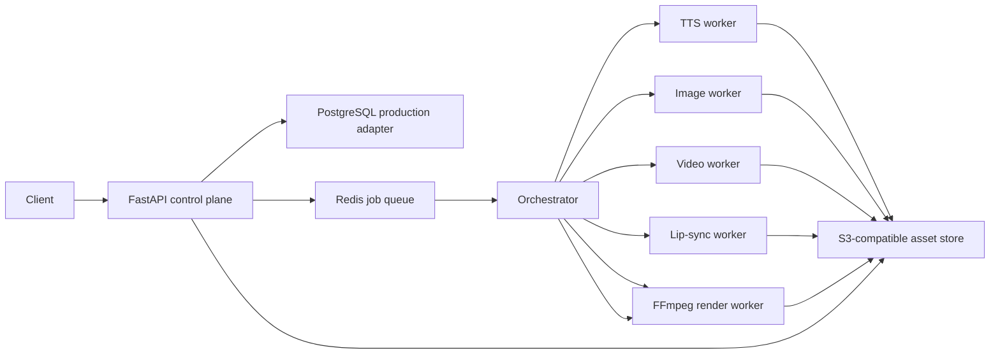
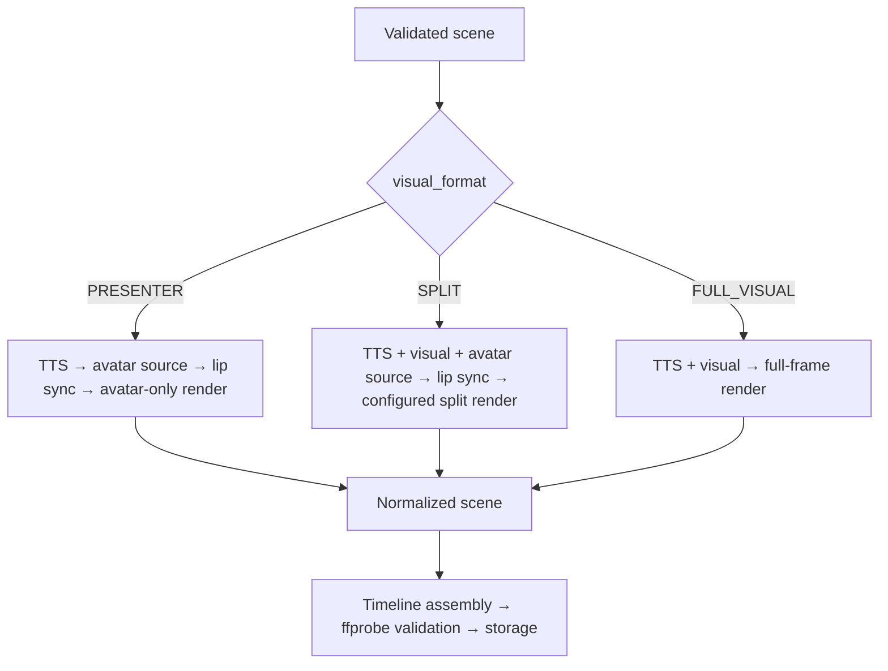

# Architecture

## Runtime shape

The local development path substitutes in-memory metadata/queue, local files, and deterministic
mocks. Production deployment must provide durable database and object-storage adapters before
multi-replica use.

## Exact scene route

Pydantic rejects invalid combinations and path-unsafe project/scene IDs before provider calls. The
pipeline verifies returned asset lineage, repeats presence assertions immediately before render,
and filtergraph construction rejects incompatible inputs. Static images receive configured
slow-zoom/pan treatment; timeline joins use normalized cuts or FFmpeg `xfade`/`acrossfade`.

## Idempotency and resume

The API binds an `Idempotency-Key` to the owner and canonical request fingerprint. Reuse of the key
with another payload returns conflict; replay returns the original job. Assets carry hashes and
parent IDs. The content-addressed cache uses provider, model, revision, prompt, seed, resolution,
steps, guidance, quantization, and settings. Atomic writes and hash verification prevent partial or
colliding cache entries.

Durable stage-level resume requires persisting `JobRecord`, asset records, and completed stage
outputs in PostgreSQL. The present in-memory repository demonstrates state semantics but cannot
survive process loss.

## Model lifecycle

`ModelLifecycleManager` supports keep-warm, first-use, idle unloading, sequential execution, and
CPU-offload strategy labels. It serializes access with configurable GPU slots. Worker supervisors
must restart the process after unrecoverable CUDA errors. One heavyweight model per GPU is the safe
default until profiling establishes compatible coexistence.

## No ComfyUI production dependency

All production boundaries are Python provider objects or internal JSON HTTP workers. `MODEL_ADAPTER`
loads a pinned Python factory. The worker refuses readiness when the adapter is absent. ComfyUI is
not installed, invoked, or referenced by any runtime command.
